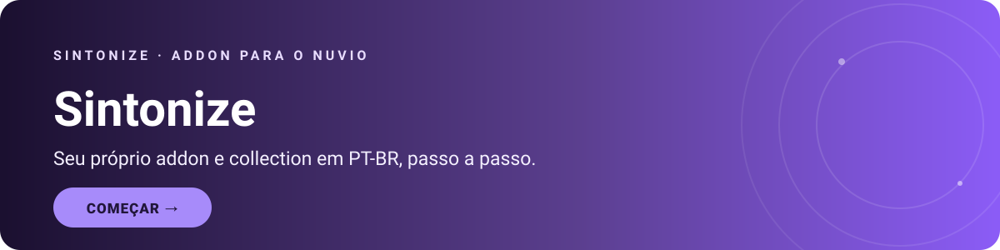

<h1 align="center">Sintonize</h1>

Seu próprio addon e collection para o Nuvio, hospedados de graça na sua conta Cloudflare.

  

  
  
  
  

  
  

---

## Sobre o projeto

O Sintonize é um addon para o Nuvio que roda como Cloudflare Worker. Ele reúne em um único manifesto catálogos e fontes de outros addons compatíveis, e oferece um painel web para configurar o projeto.

Cada pessoa hospeda e administra sua própria instância na própria conta Cloudflare. O projeto também inclui um collection para organizar coleções dentro do Nuvio.

## Como funciona

1. O Worker oferece o addon e conecta os addons compatíveis que você configurar.
2. O KV da Cloudflare armazena configurações e cache.
3. O TMDB fornece dados como títulos, capas e sinopses.
4. O painel permite administrar addons e preferências e gerar o collection pronto.
5. No Nuvio, adicione o manifesto do Worker e importe o collection gerado.

> [!TIP]
> Não precisa programar: siga o [tutorial completo](TUTORIAL.md), que explica a configuração passo a passo.

## Comece aqui

1. Abra o [tutorial completo](TUTORIAL.md).
2. Consulte o código do Worker em [`worker.js`](worker.js).
3. Consulte o modelo do collection em [`collection-template.json`](collection-template.json).

## Arquivos do projeto

| Arquivo | Para que serve |
|---|---|
| [`worker.js`](worker.js) | Código principal executado como Cloudflare Worker. |
| [`collection-template.json`](collection-template.json) | Modelo de collection que o painel transforma em um arquivo pronto com o endereço do Worker de cada pessoa. |
| [`TUTORIAL.md`](TUTORIAL.md) | Tutorial completo de configuração e uso, em português do Brasil. |
| `assets/` | Banners SVG usados nesta documentação. |

## Links úteis

- [Painel da Cloudflare](https://dash.cloudflare.com)
- [Criar conta na Cloudflare](https://dash.cloudflare.com/sign-up)
- [TMDB — configurações da API](https://www.themoviedb.org/settings/api)
- [Nuvio — conta e collections](https://nuvio.tv/account?tab=collections)
- [FrostStream](https://froststream.cloutteam.com)
- [FenixFlix](https://fenixflix.fenixhub.online)

## Segurança

> [!WARNING]
> Nunca coloque a senha de admin (`ADMIN_PASSWORD`) nem a chave do TMDB (`TMDB_API_KEY`) em nenhum arquivo do repositório, print ou mensagem. Elas ficam somente nos secrets do Cloudflare. Não compartilhe o endereço `/admin` com quem você não quer que administre seu Sintonize.

## Licença

O código deste projeto é distribuído sob a [Licença MIT](LICENSE). Consulte também a [explicação em português](LICENCA.md). A licença não concede direitos sobre marcas, serviços ou conteúdos de terceiros.

---

## Créditos e contato

- Base de collection feita por Kaptain: [github.com/ImKaptain](https://github.com/ImKaptain)
- Parte das imagens do collection vem do repositório [bramst0ne/prism-wallpapers](https://github.com/bramst0ne/prism-wallpapers).
- Este produto usa a API do TMDB, mas não é endossado nem certificado pelo TMDB.

<strong>Feito por WillianFloy</strong> Discord: <code>@willianfloy</code>

<a href="#topo">Voltar ao topo</a>

