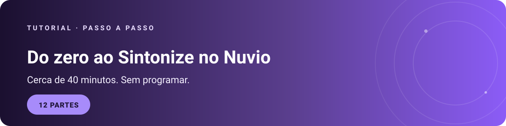
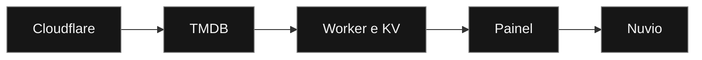
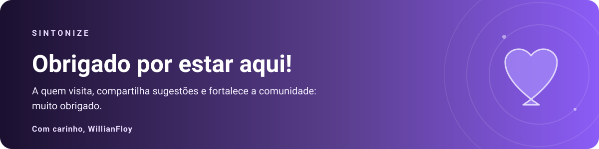

[← Voltar ao início](README.md)

Seu próprio addon Sintonize para o Nuvio, do zero. Você não precisa programar. Leva cerca de 40 minutos.

Você vai precisar de: um computador, um e-mail e o Nuvio (app ou site).

> [!IMPORTANT]
> **Regra de ouro:** nunca mostre sua senha de admin nem sua chave do TMDB para ninguém, nem em print. Quem tem essas duas coisas controla o seu Worker.

## O que é cada coisa

- **Cloudflare Worker:** o programa que roda o seu Sintonize na internet, de graça.
- **KV:** o armazenamento onde o Sintonize guarda seus addons, preferências e cache.
- **TMDB:** serviço gratuito que fornece títulos, capas e sinopses.
- **Collection:** arquivo que organiza as coleções dentro do Nuvio.

## Visão geral

O caminho tem cinco etapas: 1) Cloudflare: cria a conta onde o Sintonize vai rodar (gratuita). 2) TMDB: pega uma chave gratuita. 3) Worker e KV: o Worker é o programa e o KV guarda suas configurações. 4) Painel: você entra no /admin e configura os addons. 5) Nuvio: você adiciona o addon e importa o collection.

## Sumário

- [Visão geral](#visao-geral)
- [Parte 1: Criar a conta na Cloudflare](#parte-1)
- [Parte 2: Pegar a chave do TMDB](#parte-2)
- [Parte 3: Pegar o código do Sintonize](#parte-3)
- [Parte 4: Criar o Worker](#parte-4)
- [Parte 5: Criar o KV (o armazenamento)](#parte-5)
- [Parte 6: Ligar o KV ao Worker (binding)](#parte-6)
- [Parte 7: Criar as duas senhas (secrets)](#parte-7)
- [Parte 8: Testar se está funcionando](#parte-8)
- [Parte 9: Entrar no painel e adicionar as fontes](#parte-9)
- [Parte 10: Baixar o collection](#parte-10)
- [Parte 11: Colocar tudo no Nuvio](#parte-11)
- [Parte 12: Personalizar (opcional)](#parte-12)
- [Quando algo der errado](#quando-algo-der-errado)
- [O que nunca fazer](#o-que-nunca-fazer)

---

## Parte 1: Criar a conta na Cloudflare

**Passo 1:** Abra cloudflare.com e clique em Sign up (Cadastrar).

**Passo 2:** Digite seu e-mail e crie uma senha. Clique em Sign up.

**Passo 3:** Abra o e-mail da Cloudflare e clique em Verify email.

**Passo 4:** Ao entrar no painel, a Cloudflare normalmente já usa o plano gratuito (Free). Se aparecer uma pergunta sobre o plano, escolha Free.

> [!WARNING]
> Se pedir cartão de crédito, você está no plano pago: volte e escolha o gratuito.

Painel da Cloudflare: [dash.cloudflare.com](https://dash.cloudflare.com)

**Próxima:** [Parte 2: Pegar a chave do TMDB](#parte-2)

---

## Parte 2: Pegar a chave do TMDB

**Passo 1:** Abra themoviedb.org e clique em Sign Up (Cadastrar). Confirme o e-mail que chegar.

**Passo 2:** Entre na sua conta. Clique na sua foto ou no seu nome, no canto superior direito, e depois em Settings (Configurações).

**Passo 3:** No menu lateral, clique em API.

**Passo 4:** Se aparecer Request an API Key, clique nele e escolha Developer (Desenvolvedor).

**Passo 5:** Preencha o formulário assim:

- **Application Name:** Sintonize pessoal
- **Application URL:** pode ser qualquer endereço, por exemplo https://github.com/willianmenegazzifloy-create/sintonize
- **Application Summary:** Uso pessoal de um addon para o Nuvio

**Passo 6:** Aceite os termos e envie.

> [!NOTE]
> Se você já tinha conta no TMDB, essa etapa pode não aparecer.

**Passo 7:** Na página da API aparece a API Key, uma sequência de cerca de 32 letras e números. Copie e guarde num bloco de notas.

> [!WARNING]
> Não use a "API Read Access Token", que é a chave bem maior. Use a API Key curta.

**Próxima:** [Parte 3: Pegar o código do Sintonize](#parte-3)

---

## Parte 3: Pegar o código do Sintonize

Esta parte mudou: como o tutorial já está dentro do repositório, não é preciso navegar até o arquivo.

O código do Sintonize está neste mesmo repositório, no arquivo worker.js.

  
  

**Passo 1:** Clique em "Abrir worker.js".

**Passo 2:** No alto do arquivo, à direita, clique no ícone Copy raw file (os dois quadradinhos). Ele copia o código inteiro de uma vez.

Alternativa: clique no ícone Download raw file (seta para baixo) para baixar o arquivo, abra no Bloco de Notas, aperte Ctrl+A e depois Ctrl+C. Outra opção: abra o "Código bruto (raw)", aperte Ctrl+A e Ctrl+C.

**Passo 3:** Deixe o código copiado. Você vai colar na Parte 4.

> [!NOTE]
> O arquivo é grande (cerca de 156 KB). É normal, pode demorar um instante para carregar. Os nomes dos ícones podem variar um pouco.

> [!NOTE]
> Você não precisa baixar o collection-template.json. O painel do seu Worker busca esse modelo sozinho, aqui do GitHub.

**Próxima:** [Parte 4: Criar o Worker](#parte-4)

---

## Parte 4: Criar o Worker

O Worker é o programa que roda o seu Sintonize na Cloudflare.

**Passo 1:** No painel da Cloudflare (dash.cloudflare.com), clique em Workers & Pages no menu da esquerda (ou Compute > Workers & Pages).

**Passo 2:** Clique em Create (Criar) e depois em Start with Hello World! (ou Create Worker, conforme a tela).

**Passo 3:** Em Name (Nome), digite o nome que você quiser para o seu Worker. Não precisa ser "meu-sintonize"; esse nome vira parte do endereço.

**Passo 4:** Clique em Deploy. Na primeira vez, a Cloudflare pede para criar um subdomínio workers.dev. Escolha um nome curto, como seu apelido. Ele aparece em todos os seus Workers.

> [!IMPORTANT]
> **Como ler os endereços deste tutorial:** depois do deploy, o endereço do seu Worker fica assim: `https://NOME-DO-WORKER.SEU-SUBDOMINIO.workers.dev`. `NOME-DO-WORKER` é o nome que você escolheu no passo 3. `SEU-SUBDOMINIO` é o subdomínio workers.dev que a Cloudflare criou para você. Em todo o tutorial, troque esses dois pelo que é seu. Anote o seu endereço completo, você vai usar várias vezes.

**Passo 5:** Na página do Worker, clique em Edit code (Editar código).

**Passo 6:** Clique dentro do editor, aperte Ctrl+A e depois Delete para apagar o código de exemplo.

**Passo 7:** Aperte Ctrl+V para colar o código do Sintonize que você copiou na Parte 3.

**Passo 8:** Clique em Deploy no canto superior direito.

> [!NOTE]
> Nesse ponto o Worker está no ar, mas ainda não funciona completamente. Faltam o KV e as chaves.

**Próxima:** [Parte 5: Criar o KV (o armazenamento)](#parte-5)

---

## Parte 5: Criar o KV (o armazenamento)

O KV guarda a sua lista de addons, as preferências e o cache.

**Passo 1:** No painel da Cloudflare, clique em Storage & databases (ou Storage & Compute) no menu da esquerda. Depois clique em Workers KV. Em algumas telas aparece só KV.

**Passo 2:** Clique em Create a KV namespace (ou Create instance).

**Passo 3:** Em Namespace name, digite exatamente: `sintonize-cache`

**Passo 4:** Clique em Add ou Create.

**Próxima:** [Parte 6: Ligar o KV ao Worker (binding)](#parte-6)

---

## Parte 6: Ligar o KV ao Worker (binding)

Esse passo faz o Worker enxergar o KV com o nome que o código espera.

**Passo 1:** Volte em Workers & Pages e clique no seu Worker.

**Passo 2:** Clique na aba Settings (Configurações), no topo.

**Passo 3:** Na seção Bindings (Vínculos), clique em Add binding (Adicionar vínculo).

**Passo 4:** Escolha o tipo KV namespace.

**Passo 5:** Em Variable name, digite exatamente: `CACHE` (tudo maiúsculo, sem espaço). Em KV namespace, escolha sintonize-cache.

> [!WARNING]
> Se o nome da variável estiver diferente de CACHE, o Sintonize não encontra o armazenamento.

**Passo 6:** Clique em Save ou Add binding. O binding CACHE deve aparecer na lista.

**Próxima:** [Parte 7: Criar as duas senhas (secrets)](#parte-7)

---

## Parte 7: Criar as duas senhas (secrets)

Secrets são valores escondidos. Depois de salvar, você não consegue ver de novo, e isso é de propósito.

**Passo 1:** Ainda em Settings do Worker, vá em Variables and secrets (Variáveis e segredos).

**Passo 2:** Clique em Add. Em Type, escolha Secret. Não use Text para essas duas.

**Passo 3:** Senha do painel. Variable name: `ADMIN_PASSWORD`. Value: a senha que você vai usar para entrar no painel. Use uma senha forte e anote num lugar seguro.

**Passo 4:** Chave do TMDB. Clique em Add de novo, com Type em Secret. Variable name: `TMDB_API_KEY`. Value: a API Key do TMDB (Parte 2, passo 7).

**Passo 5:** Salve. Não coloque espaço antes ou depois dos valores e não use aspas. Ao salvar os secrets, a Cloudflare faz o deploy sozinha: você não precisa clicar em Deploy.

**Próxima:** [Parte 8: Testar se está funcionando](#parte-8)

---

## Parte 8: Testar se está funcionando

**Passo 1:** Abra uma aba nova e cole o endereço do seu Worker: `https://NOME-DO-WORKER.SEU-SUBDOMINIO.workers.dev/`

**Passo 2:** Devem aparecer três linhas em Pronto: Secret TMDB_API_KEY, Secret ADMIN_PASSWORD e KV com o nome CACHE.

Se alguma aparecer como Faltando:

- **TMDB_API_KEY ou ADMIN_PASSWORD:** o secret não foi salvo ou o nome está errado. Volte à Parte 7.
- **KV com o nome CACHE:** o binding está com outro nome ou não foi salvo. Volte à Parte 6.
- Depois de corrigir, espere alguns segundos e recarregue a página com Ctrl+F5.

**Próxima:** [Parte 9: Entrar no painel e adicionar as fontes](#parte-9)

---

## Parte 9: Entrar no painel e adicionar as fontes

**Passo 1:** Abra `https://NOME-DO-WORKER.SEU-SUBDOMINIO.workers.dev/admin`.

**Passo 2:** Digite a senha do ADMIN_PASSWORD e clique em Entrar no painel.

**Passo 3:** No menu da esquerda, clique em Addons. Você vai ver os cartões dos parceiros recomendados, FrostStream e FenixFlix, ambos gratuitos e sem TorBox.

> [!TIP]
> Usar os parceiros é recomendado, mas não é obrigatório. Você também pode adicionar os seus próprios addons, desde que sejam compatíveis (o link do addon termina em manifest.json).

**Passo 4:** Clique em Abrir site no FrostStream. Ele abre o site oficial (froststream.cloutteam.com). Siga as instruções de lá para pegar o link do manifesto, que sempre termina em manifest.json. Copie esse link.

**Passo 5:** Volte ao painel, cole o link no campo Endereço do addon, em Conectar um addon, e clique em Validar e adicionar.

**Passo 6:** Se aparecer uma mensagem verde com o nome e a quantidade de catálogos, deu certo.

**Passo 7:** Repita os passos 4 a 6 para o FenixFlix (fenixflix.fenixhub.online).

> [!NOTE]
> Se der erro no FenixFlix, pode continuar usando só o FrostStream.

**Passo 8:** Clique em Salvar tudo, no canto superior direito.

> [!WARNING]
> Sempre clique em Salvar tudo depois de qualquer mudança no painel, senão ela se perde.

Se der erro ao validar, confira se o link está completo e termina em manifest.json, e se o site do parceiro está funcionando.

**Próxima:** [Parte 10: Baixar o collection](#parte-10)

---

## Parte 10: Baixar o collection

O collection organiza as coleções no Nuvio e já vem com o endereço do seu Worker.

**Passo 1:** No painel, clique em Collection no menu da esquerda.

**Passo 2:** Clique em Baixar collection pronto.

**Passo 3:** O navegador baixa o arquivo sintonize-collection.json (cerca de 3 MB). Guarde-o num lugar fácil de achar, como a pasta Downloads. Você não precisa editar nada nele.

> [!NOTE]
> Se aparecer um erro, espere alguns minutos e tente de novo.

**Próxima:** [Parte 11: Colocar tudo no Nuvio](#parte-11)

---

## Parte 11: Colocar tudo no Nuvio

Aqui o addon é adicionado pelo app do Nuvio e o collection é importado pelo site. Também dá para importar o collection pelo app (o caminho é parecido), mas este tutorial usa o site.

### 11.1: Adicionar o addon (pelo app do Nuvio)

**Passo 1:** Abra o app do Nuvio e vá na área de Addons (ou Complementos).

**Passo 2:** Você vai colar o endereço do manifesto do seu Worker. Para achá-lo, abra o endereço do painel, `https://NOME-DO-WORKER.SEU-SUBDOMINIO.workers.dev/admin`, e troque o final /admin por /manifest.json. Fica assim: `https://NOME-DO-WORKER.SEU-SUBDOMINIO.workers.dev/manifest.json`

Cole esse endereço no campo de adicionar addon e confirme (Add ou Adicionar).

**Passo 3:** Se o nome Sintonize aparecer na lista de addons, deu certo.

### 11.2: Remover o que pode dar conflito

> [!IMPORTANT]
> O Nuvio pode vir com um catálogo padrão e você pode já ter uma collection antiga. Os dois podem gerar conflito com o Sintonize. Deixe a conta limpa antes de importar.

**Passo 1:** Ainda na área de Addons do app, procure o catálogo padrão do Nuvio. Se existir, remova ou desative.

**Passo 2:** Pelo site, abra [nuvio.tv/account?tab=collections](https://nuvio.tv/account?tab=collections) e entre na sua conta. Se já houver collections suas, anote os nomes do que você quer guardar. Se a lista estiver vazia, como na imagem, pule para o próximo passo.

**Passo 3:** Remova as collections antigas. Recomendamos remover as antigas antes de adicionar a nova que você baixou.

> [!WARNING]
> A remoção não tem como desfazer. Confira antes de apagar.

### 11.3: Importar o collection (pelo site)

**Passo 1:** Em [nuvio.tv/account?tab=collections](https://nuvio.tv/account?tab=collections), clique em Import (ou Importar).

**Passo 2:** Selecione o arquivo sintonize-collection.json que você baixou na Parte 10.

**Passo 3:** Confirme. As coleções devem aparecer na lista.

> [!NOTE]
> Pelo app também dá: Configurações (ou sua conta), depois Collections, depois Importar. Os nomes das telas podem mudar de uma versão para outra.

### 11.4: Testar

Abra um filme ou uma série no Nuvio. Se aparecerem fontes com o nome do Sintonize, está funcionando.

Se não aparecer nada, confira se o addon foi adicionado pelo manifest.json e se o Worker abre no navegador.

**Próxima:** [Parte 12: Personalizar (opcional)](#parte-12)

---

## Parte 12: Personalizar (opcional)

### Explorar o painel

Entre em `https://NOME-DO-WORKER.SEU-SUBDOMINIO.workers.dev/admin` e explore à vontade. O menu da esquerda tem estas abas:

- **Visão geral**
- **Addons:** seus addons, preferências rápidas, parceiros recomendados, conectar um addon e sua biblioteca
- **Qualidade:** ajustes de qualidade das fontes
- **Idiomas:** ajustes de idioma
- **Apresentação:** como as fontes aparecem (formatação das fontes, importar formatação)
- **Collection:** baixar o collection pronto
- **Backup & ferramentas:** backup e manutenção, armazenamento

> [!WARNING]
> Depois de qualquer mudança, clique em Salvar tudo. Sem isso, a mudança não vale.

### Trocar a logo sem mexer no código

**Passo 1:** No Cloudflare, abra o seu Worker e vá em Settings > Variables and secrets.

**Passo 2:** Clique em Add, escolha o tipo Text (não Secret) e preencha: Variable name: `LOGO_URL`. Value: o link direto da imagem, que termina em .jpg, .png ou .jpeg.

**Passo 3:** Salve. A Cloudflare aplica sozinha. Espere alguns segundos e recarregue a página do painel com Ctrl+F5.

> [!NOTE]
> Use um link que não expire. Links do Discord expiram.

**Próxima:** [Quando algo der errado](#quando-algo-der-errado)

---

## Quando algo der errado

| Sintoma | O que fazer |
|---|---|
| Página do Worker dá erro 404 ou "Not found" | Confira o endereço. Deve ser o do Worker, não o do painel da Cloudflare. |
| /admin diz "Não autorizado" | A senha está errada. Confira o ADMIN_PASSWORD. |
| O painel não salva e mostra erro de KV | O binding CACHE não está ligado. Volte à Parte 6. |
| A página inicial mostra "Faltando" | Volte às Partes 6 e 7 e confira os nomes, em maiúsculas. |
| Uma mudança não aparece | Espere alguns segundos e recarregue com Ctrl+F5. No painel, confira se clicou em Salvar tudo. |
| O collection dá erro ao baixar | Espere alguns minutos e tente de novo. |
| O Nuvio não mostra nada | Confira se o addon foi adicionado pelo manifest.json e se o Worker abre no navegador. |

## O que nunca fazer

- Não mostre a senha de admin nem a chave do TMDB em print, mensagem ou código.
- Não coloque a chave do TMDB dentro do worker.js. Ela fica só nos secrets.
- Não compartilhe o endereço /admin com quem você não quer que mexa no seu Sintonize.

---

<a href="README.md">← Voltar ao início</a> · <a href="#topo">Voltar ao topo</a>

